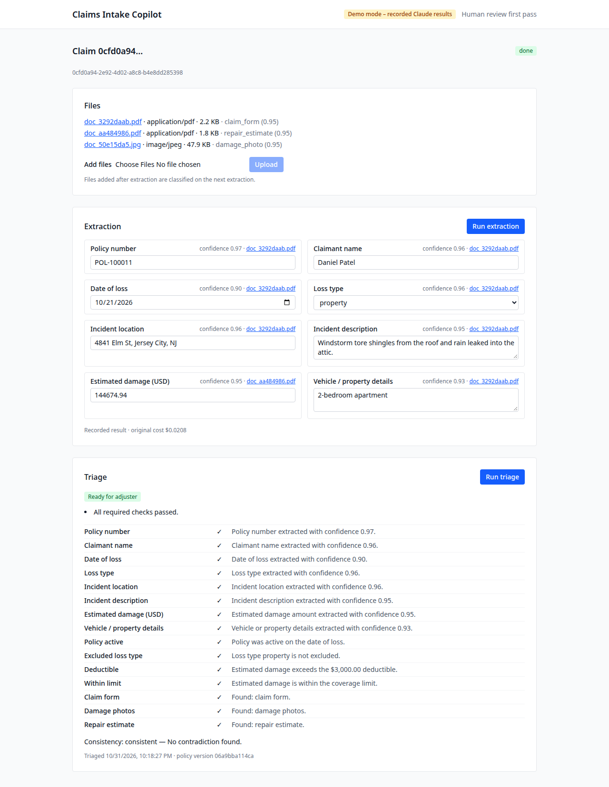
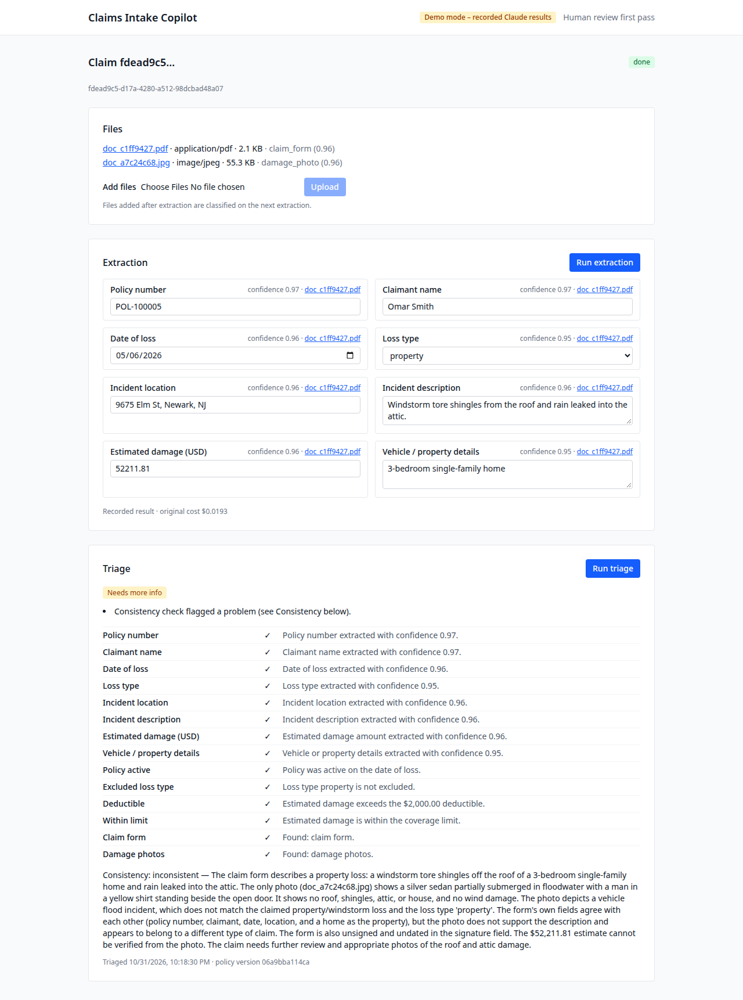
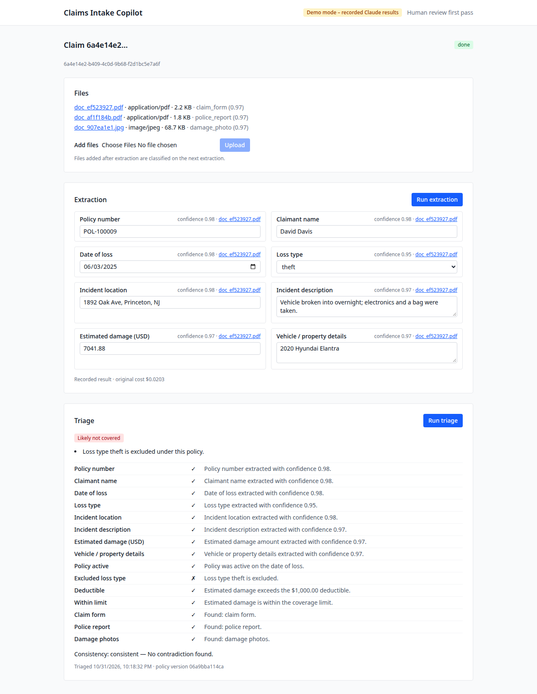
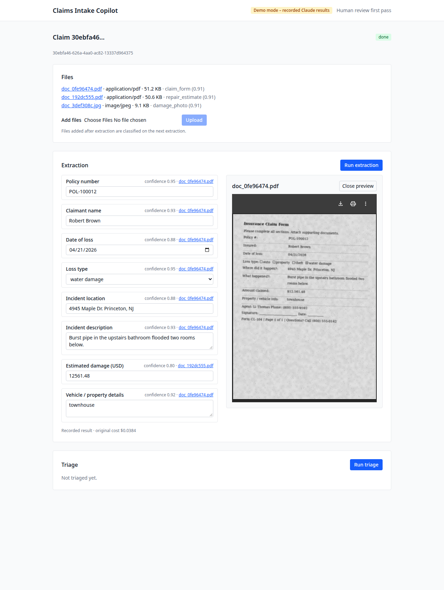
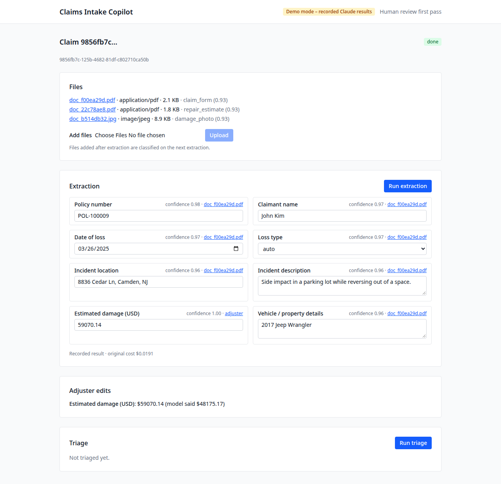
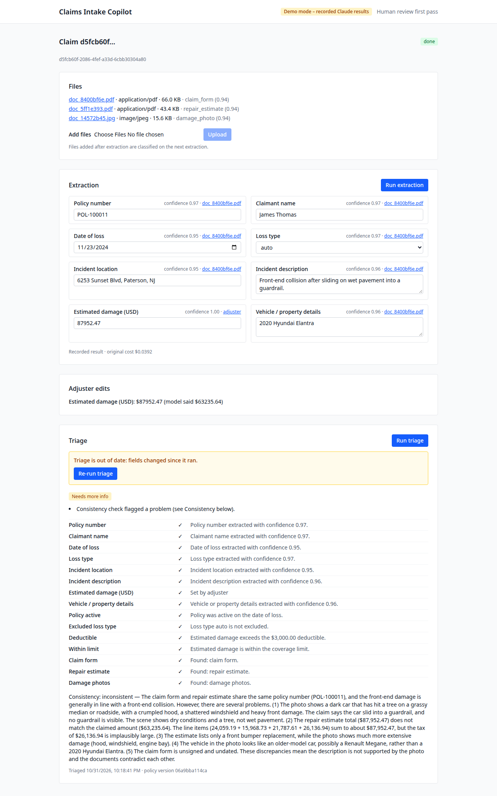
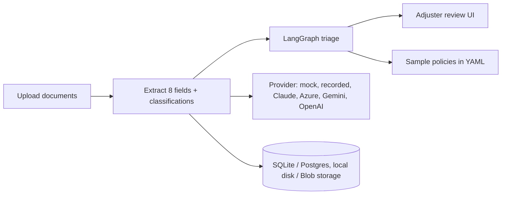

# Insurance Claims Intake Copilot

[](https://github.com/hari131415/insurance-claims-copilot/actions/workflows/ci.yml)

**At a glance** (evaluated live on Claude, 300 synthetic claims):
97% field accuracy, 100% document classification, about $0.02 per
claim. On a 200-claim held-out test split, prompt and confidence-gate
fixes cut consistency false alarms from 58% to 49% and wrong
coverage-review routings from 2 to 0. Details and caveats in
[Results](#results) and [Limitations](#limitations-and-next-steps).

Claim intake, first pass only. An adjuster uploads claim documents
(forms, estimates, police reports, damage photos); the app extracts
eight fields with confidence scores and source files, runs a
deterministic triage graph with one LLM judgment call (consistency
across documents and photos), and routes the claim to
ready_for_adjuster, needs_more_info, or the coverage-review queue
(likely_not_covered). Every route goes to a human adjuster, who
edits fields and makes the final decision. The app never decides a
claim on its own.

Stack: React + TypeScript (Vite) frontend, Python FastAPI backend
with Pydantic v2 and SQLModel, LangGraph triage, declarative sample
policies in YAML. The LLM layer is a provider abstraction (Azure
OpenAI, Gemini, Anthropic, standard OpenAI) plus a deterministic
mock provider and a recorded provider, so the app, tests, and CI
run with no API keys.

## Run it locally

```sh
# Backend (from backend/): create a virtualenv, install, serve on :8000
python -m venv .venv
.venv/bin/pip install -e ".[dev]"
.venv/bin/uvicorn claims_copilot.main:create_app --factory --port 8000

# Frontend (from frontend/): serves on :5173, talks to :8000
npm install
npm run dev
```

On Windows, use `.venv\Scripts\` in place of `.venv/bin/`.

The mock provider is the default, so local runs need no keys. For a
real provider, set `LLM_PROVIDER` and the provider's key and model
in the environment (see `.env.example`); keys are never committed.

For a demo with real model outputs and no API key, use the
recorded provider:

```sh
LLM_PROVIDER=recorded .venv/bin/uvicorn claims_copilot.main:create_app --factory --port 8000
```

It replays the saved Claude full-run outputs for dataset files,
matched by file content hash, and the header badge reads "Demo
mode – recorded Claude results". Files outside the dataset fail
with a clear message. Regenerate the dataset from the repo root
with `backend/.venv/bin/python evals/generate.py` (seed 42,
byte-identical output). Two pieces the eval run did not save are
reconstructed and documented in the recording header: per-field
source files (the dataset document that states the value) and
classification confidences (the claim's mean field confidence).

## Demo

Screenshots from the recorded demo mode, using real dataset
claims and saved Claude outputs.













## Architecture



Uploads stream to storage with content-type validation. Extraction
runs as a background task and the UI polls while it is processing;
confidence scores are the model's self-reported values, adjusted
by deterministic cross-checks (malformed policy numbers, unknown
policies, future dates, non-positive amounts). Triage is a linear
LangGraph graph: validate extraction, check coverage against the
policy, check required documents, run the consistency judge, then
decide the route. Coverage-queue routing requires the deciding
field's confidence to clear a 0.9 bar; below it, the claim goes
to needs_more_info instead. Adjuster edits are stored as overrides
separate from the model output, so both values are always visible
and triage can be re-run on the edited fields.

## Results

Only Claude (claude-sonnet-5-5) was evaluated live. The Azure,
Gemini, and standard OpenAI adapters are tested against stubbed
SDK responses only; their live behavior, and Azure strict JSON
Schema mode, are unverified.

### Full-run baseline: all 300 claims, original prompts

Anthropic full run, 300/300 ok, $6.1220 total ($0.020407/claim),
latency p50 7.66s / p95 21.36s per claim:

- Field accuracy 97.2%, classification accuracy 100%,
  route accuracy 75.7% (227/300)
- Conflict detection 27/30 (90%), photo-mismatch detection
  18/18 (100%)
- Consistency judge: precision 23.4%, false-alarm rate 58.3%,
  recall 93.8%
- Dangerous errors 3 (routed to the coverage-review queue
  against their labels, all via an excluded loss type)

### Test split: 200 held-out claims, before/after the fixes

Split seed 123: 100 dev claims for tuning, 200 test claims never
used for tuning. The fixes: a stated-only extraction prompt
(null when a field isn't stated, never infer), an exclusion bar
(0.9) for coverage-queue routing, a 0.7 low-confidence
threshold, and a consistency prompt that flags only specific
two-source contradictions with major/minor severity (only major
routes to needs_more_info). The after run is mixed by design:
37 test claims with an absent field got full re-runs, 163
fully-stated claims reused saved extractions with a live
consistency call only.

| Metric | Before | After |
| --- | --- | --- |
| Field accuracy | 97.6% (1561/1600) | 99.8% (1597/1600) |
| Route accuracy | 76.5% (153/200) | 78.5% (157/200) |
| Consistency precision | 27.7% | 31.3% |
| Consistency recall | 94.7% | 94.7% |
| False-alarm rate | 58.0% | 48.8% |
| Dangerous errors | 2 | 0 |
| Cost per claim | $0.0207 | $0.0103 (mixed-method artifact, see below) |

Two readings need care. The field accuracy after figure reuses
163/200 extractions unchanged, so its improvement concentrates
in the 37 full re-runs, where the stated-only prompt turned
inferred values into correct abstentions. And $0.0103 is what
the mixed re-run cost, not what the pipeline costs:
full-pipeline cost is ~$0.02/claim (the 37 full re-runs
averaged $0.020981), the same as before. Expected-ready claims
reaching ready: 10/54 before, 16/54 after.

Full detail lives in `evals/README.md` and the reports under
`evals/results/`; the harness itself is documented in
`evals/README.md`.

## Limitations and next steps

- The judge still over-flags. Only 16/54 expected-ready claims
  reach ready_for_adjuster after the fixes (10/54 before), and
  the test-split false-alarm rate is 48.8%. A post-eval audit
  of all 79 false alarms (saved data only, no API calls)
  found every one cites a photo-vs-description difference,
  and most trace to the generator pooling photos by loss
  type only: the photo rarely depicts the specific narrative
  (a tree crash for a parking-lot side impact, exterior
  floodwater for an interior leak), so the judge flags a
  difference the generator created. Details sampled
  independently of the narrative (41/79) and fixed estimate
  templates (38/79) contribute the rest. The 48.8% rate
  therefore overstates judge error, but the true post-fix
  rate is unknown until a re-run on a v2 dataset, which
  has no budget yet.
- Next step: extract amounts per document and check amount
  conflicts deterministically in code, leaving the LLM judge
  only for photo-vs-description and other judgment cases.
  Amount disagreements are the most checkable contradiction
  class, and a code check does not hallucinate one.
- Severity barely fired: only 2 minor verdicts were observed
  in the test run, so the major/minor mechanism is barely
  exercised. Its value is unproven until a run produces a
  meaningful number of minor verdicts.
- The dataset is synthetic (300 generated claims, seed 42),
  so results measure the pipeline against its own generator's
  idea of a claim, not against real intake. Theft photos are
  limited to a single image, reused across theft claims.
  The eval dataset itself has known flaws, found by the
  false-alarm audit: generated forms had blank signature
  and date lines, theft narratives included shed and garage
  thefts paired with a car photo, details sometimes
  contradicted the narrative (a vehicle on a shed theft,
  a single-story ranch with an upstairs bathroom), and
  estimate tax lines were implausible (tax as a random
  share of the total, e.g. $26,136.94 on claim-0005).
  Dataset version 2 fixes all four (filled signature/date,
  vehicle-break-in theft narratives, narrative-consistent
  details, tax as a small percentage of parts and labor),
  but the current dataset and results are version 1, and
  photos are still pooled by loss type only even in v2,
  so they often contradict the specific narrative. The
  generator defaults to version 1, which reproduces the
  eval dataset byte-identically; version 2 is opt-in via
  `--dataset-version 2`. See `evals/README.md`.
- Single-provider eval: only Claude was run live. Azure
  strict JSON Schema mode is built but untested, and the
  other adapters have no live numbers at all.
- Background extraction runs in-process (FastAPI
  BackgroundTasks). On an Azure Functions Consumption plan
  that work can be cut off; the production path is a queue
  or Durable Functions. See `azure-functions/README.md`.
- Production hardening is out of scope for this portfolio
  build: no auth, no rate limiting, no migrations
  (`create_all` only), single-worker background jobs.

## Continuous integration and deployment

GitHub Actions (`.github/workflows/ci.yml`) runs four jobs:
backend (ruff, mypy, pytest, plus evals lint and type check),
frontend (eslint, tsc, build), Playwright end-to-end tests
against the real stack with the mock provider and the recorded
provider, and the Azure Blob round-trip test against the Azurite
storage emulator (started in the job with its API version check
skipped). The backend job regenerates the eval dataset first, since
the generated files are not committed.

For containers: `docker compose up --build` serves the api on
:8000 and the web frontend on :5173 (Azurite included for
blob-storage work). The frontend bakes `VITE_API_URL` into the
bundle at build time: compose passes it as a build argument
(default http://localhost:8000), so pointing the web image at a
different api means rebuilding the image, not restarting the
container. `azure-functions/` holds the Functions config that
serves the same FastAPI app through the ASGI bridge; its README
covers the settings and the packaging step. Neither the Docker
builds nor a Functions deployment have run yet; see
`docs/decisions.md` for what is verified and what is not.

## Layout

- `backend/` — FastAPI app, triage graph, provider adapters,
  sample policies, tests
- `frontend/` — React upload and review UI, Playwright tests
- `evals/` — synthetic dataset generator, runners, reports
- `docs/` — decisions log, screenshots
- `azure-functions/` — Functions config for the same FastAPI app